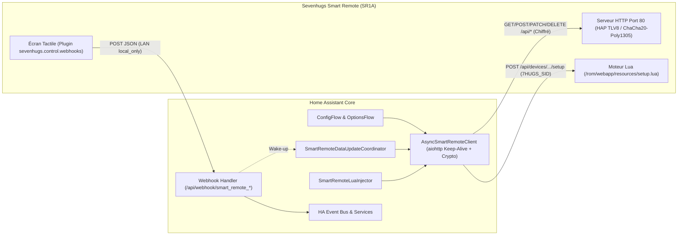

# Product Requirements Document (PRD) — Smart Remote Rebirth (`SR1A`)

---

## 1. Métadonnées et Rôle du Document

| Propriété | Valeur |
| :--- | :--- |
| **Nom du projet** | Smart Remote Rebirth (`smart_remote_rebirth`) |
| **Statut du document** | **Source Unique de Vérité (Single Source of Truth)** |
| **Version actuelle** | `0.4.1` (Cible d'alignement : `0.5.0`) |
| **Matériel cible** | Sevenhugs Smart Remote (Modèle `SR1A`, FCC ID `2AEVC-SR1A`) |
| **Firmware de référence** | `0.76.4-19.6.3-ae` (`API Version 31`, `Min Version 24`) |
| **Plateforme cible** | Home Assistant Core `2024.1+` / `2026.11+` (HACS & Marketplace) |
| **Licence** | MIT |

> [!IMPORTANT]
> Ce PRD constitue la **référence normative unique** du dépôt. Toute évolution du code, des tests ou de la documentation doit respecter les contrats d'architecture, de périmètre et de nommage définis ici.
> - Pour la spécification bas niveau du protocole cryptographique et des routes HTTP : voir [`docs/PROTOCOL_AND_API.md`](PROTOCOL_AND_API.md).
> - Pour l'architecture du banc de test autonome : voir [`docs/TEST_INFRA.md`](TEST_INFRA.md).

---

## 2. Vision Produit, Périmètre et Non-Objectifs

### 2.1. Problématique & Contexte
En mai 2022, l'arrêt définitif des serveurs cloud `*.sevenhugs.com` (`cdn.prod.cobra.sevenhugs.com`, `auth.sevenhugs.com`) a rendu l'application mobile officielle (`com.sevenhugs.smartremote`) inopérante (écran blanc dans le WebView lors de la configuration). Bien que le matériel de la télécommande **Sevenhugs Smart Remote (`SR1A`)** soit parfaitement fonctionnel, les appareils réinitialisés ou coupés du cloud se sont retrouvés inutilisables.

La rétro-ingénierie du firmware `0.76.4-19.6.3-ae` a démontré que la télécommande embarque en mémoire ROM un serveur HTTP autonome (port TCP `80`), une pile cryptographique locale dérivée de HomeKit HAP (SRP-6a 3072-bit, Ed25519, X25519, ChaCha20-Poly1305) ainsi qu'un moteur d'assistants Lua complet (`/rom/webapp/resources/setup.lua`) permettant de configurer des requêtes HTTP locales via le plugin `sevenhugs.control.webhooks`.

### 2.2. Objectif Produit
Offrir une seconde vie **100 % locale, durable et sans cloud** à la télécommande Sevenhugs Smart Remote en la recyclant comme **contrôleur tactile universel pour Home Assistant**, avec :
1. Une installation et un appairage **100 % graphiques** dans Home Assistant (zéro ligne de commande, zéro fichier YAML manuel).
2. Un déclenchement instantané des entités, scènes et automatisations Home Assistant via des webhooks locaux sécurisés.
3. Une boîte à outils CLI autonome (`tools/`) préservée pour l'exploration matérielle et le diagnostic hors Home Assistant.

### 2.3. Hors-Périmètre Explicite (Non-Goals)
Afin de garantir la cohérence et la maintenabilité du projet, les éléments suivants sont **exclus du périmètre** :
- **Restauration des fonctions cloud défuntes** : La base de données infrarouge cloud, le widget météo externe et les intégrations cloud propriétaires ne sont pas recréés.
- **Point Mode UWB (balises de localisation)** : Non requis pour l'usage en contrôleur de webhooks Home Assistant.
- **Architecture à base d'Add-on Docker séparé** : Écartée définitivement car incompatible avec *Home Assistant Container* et *Home Assistant Core*, et inutilement lourde en ressources.
- **Capteurs de télémétrie non exposés par le firmware `v0.76.4`** : L'endpoint réel `GET /api/settings` du firmware `v0.76.4` retourne uniquement les métadonnées système (`serial_number`, `id`, `firmware_version`, `mac_address`, `carousel_order`). Il **n'expose pas** le niveau de batterie (`battery`), la puissance Wi-Fi (`wifi_signal`), l'état du socle de charge (`charging`) ni l'écran actif (`active_screen`). Ces capteurs fantômes ne font pas partie du produit et doivent être supprimés du code (`sensor.py` retiré).

---

## 3. Architecture et Structure Canonique du Dépôt

### 3.1. Choix Architectural : Intégration HACS Pure
L'intégration fonctionne exclusivement comme un composant natif asynchrone (`custom_components/smart_remote_rebirth/`) au sein de l'Event Loop de Home Assistant Core :
- **Compatibilité universelle (100 %)** : Fonctionne sur *Home Assistant OS*, *Supervised*, *Container* et *Core*.
- **Zéro port d'écoute supplémentaire** : Utilise `aiohttp` en sortie (TCP 80 vers la télécommande), le composant natif `zeroconf` (UDP 5353) pour la découverte mDNS, et le routeur natif `webhook` de Home Assistant (port 8123 existant).
- **Exécution non-bloquante** : Les calculs intensifs SRP-6a 3072-bit sont délégués au pool d'exécution (`hass.async_add_executor_job`).



### 3.2. Arborescence Canonique en 4 Piliers
Le dépôt est structuré autour de quatre répertoires racine strictement délimités :

```text
smart-remote-rebirth/
├── .github/workflows/                      # Pipelines CI/CD (Ruff, Tests, HACS, Hassfest, Release)
├── custom_components/
│   └── smart_remote_rebirth/               # Pilier 1 : Intégration Home Assistant de production
│       ├── brand/                          # Icônes et logos HACS / Home Assistant (icon.png, logo.png)
│       ├── translations/                   # Traductions UI localisées (en.json, fr.json)
│       ├── __init__.py                     # Cycle de vie ConfigEntry (setup, unload, reload)
│       ├── binary_sensor.py                # Capteur binaire de connectivité (connectivity)
│       ├── button.py                       # 3 boutons d'action (force_sync, ping, backup_config)
│       ├── client.py                       # Client HTTP Keep-Alive asynchrone et gestion de session
│       ├── config_flow.py                  # ConfigFlow (mDNS, IP, PIN, reauth, reconfigure) & OptionsFlow
│       ├── const.py                        # Constantes normatives du domaine
│       ├── coordinator.py                  # DataUpdateCoordinator et résilience Deep Sleep
│       ├── crypto.py                       # Primitives TLV8, SRP-6a, Ed25519, X25519, ChaCha20-Poly1305
│       ├── entity.py                       # Classe de base commune et rattachement au Device Registry
│       ├── lua_injector.py                 # Automatisation Server-Driven UI Lua (webhooks)
│       ├── manifest.json                   # Métadonnées Home Assistant / HACS
│       ├── strings.json                    # Chaînes de référence du ConfigFlow / OptionsFlow / Entités
│       └── webhook.py                      # Réception locale sécurisée, validation et dispatch HA
├── docs/                                   # Pilier 2 : Documentation de référence
│   ├── PRD.md                              # Ce document (Source Unique de Vérité produit & architecture)
│   ├── PROTOCOL_AND_API.md                 # Spécification rétro-ingénierie du protocole et de l'API
│   └── TEST_INFRA.md                       # Architecture et méthodologie du banc de test
├── tests/                                  # Pilier 3 : Suite de tests automatisés (100% exécutés en CI)
│   ├── conftest.py                         # MockSmartRemoteServer (émulateur matériel TCP Keep-Alive)
│   ├── ha_mock.py                          # Mocks autonomes du noyau Home Assistant
│   └── test_*.py                           # Tests unitaires, résilience, concurrence et E2E
├── tools/                                  # Pilier 4 : Boîte à outils CLI & exploration hors-HA
│   ├── pair_and_verify.py                  # Jumelage initial interactif en ligne de commande
│   ├── pair_verify.py                      # Vérification de session et extraction de dumps JSON
│   ├── poc_quickstart.py                   # Démonstrateur autonome (serveur virtuel ou IP physique)
│   ├── sevenhugs_bridge.py                 # Passerelle et studio Web autonome historique
│   └── smartremote_keys.example.json       # Modèle de fichier de clés pour les outils CLI
├── hacs.json                               # Déclaration de compatibilité HACS
├── pyproject.toml                          # Configuration du linter Ruff (Python 3.12+)
├── requirements.txt                        # Dépendances de test/CLI (cryptography, aiohttp, voluptuous)
├── README.md                               # Documentation utilisateur principale (Anglais)
└── README.fr.md                            # Documentation utilisateur principale (Français)
```

### 3.3. Règles d'Hygiène du Dépôt et des Tests
1. **Exécution CI à 100 %** : La commande CI `python -m unittest discover tests` exécute uniquement les fichiers correspondant au motif `test_*.py`. Tout harnais de test dans `tests/` destiné à la validation continue doit impérativement être préfixé par `test_` (ou regroupé proprement).
2. **Exclusion stricte des artefacts locaux (`.gitignore`)** : Les fichiers binaires d'analyse (`*.apk`, `*.dex`), les clés privées personnelles (`smartremote_keys.json`), les dumps d'état personnels (`*_dump.json`, `tools/dumps/`) et les environnements virtuels (`venv/`, `.pylib/`) ne doivent jamais être committés.

---

## 4. Conventions de Nommage et Contrats d'Interfaces

### 4.1. Identifiants Publics Home Assistant (`smart_remote_*`)
Tous les identifiants exposés dans Home Assistant utilisent exclusivement le préfixe **`smart_remote_`** :

| Contrat | Valeur Normative | Fichier Source |
| :--- | :--- | :--- |
| **Domaine de l'intégration (`DOMAIN`)** | `"smart_remote_rebirth"` | `const.py` |
| **Préfixe d'identifiant Webhook (`WEBHOOK_ID_PREFIX`)** | `"smart_remote_"` (ex: `smart_remote_{entry_id}`) | `const.py` / `webhook.py` |
| **Route HTTP du Webhook** | `/api/webhook/smart_remote_{entry_id}` | `webhook.py` |
| **Événement Bus Home Assistant (`EVENT_BUTTON_PRESSED`)** | `"smart_remote_button_pressed"` | `const.py` / `webhook.py` |

### 4.2. Convention de Nommage des Classes Python (`SmartRemote*`)
Pour éviter toute ambiguïté et maintenir une cohérence totale avec le domaine `smart_remote_rebirth` et la clause de non-affiliation, les classes internes du composant suivent la convention **`SmartRemote*`** (cible v0.5) :

| Rôle | Nom Canonique Cible (`SmartRemote*`) | Alias Rétro-compatible (Déprécié) |
| :--- | :--- | :--- |
| **Client HTTP & Crypto** | `AsyncSmartRemoteClient` | — |
| **Exceptions Client** | `SmartRemoteError`, `SmartRemoteAuthError`, `SmartRemoteConnectionError` | `SevenhugsError`, `SevenhugsAuthError`, `SevenhugsConnectionError` |
| **Coordinateur de données** | `SmartRemoteDataUpdateCoordinator` | `SevenhugsDataUpdateCoordinator` |
| **Flux de configuration** | `SmartRemoteConfigFlow`, `SmartRemoteOptionsFlow` | `SevenhugsConfigFlow`, `SevenhugsOptionsFlow` |
| **Entité de base** | `SmartRemoteBaseEntity` | `SevenhugsBaseEntity` |
| **Capteur binaire** | `SmartRemoteConnectivityBinarySensor` | `SevenhugsConnectivityBinarySensor` |
| **Boutons de maintenance** | `SmartRemoteForceSyncButton`, `SmartRemotePingButton`, `SmartRemoteBackupConfigButton` | `SevenhugsForceSyncButton`, `SevenhugsPingButton`, `SevenhugsBackupConfigButton` |
| **Injecteur Lua** | `SmartRemoteLuaInjector` | `SevenhugsLuaInjector` |

### 4.3. Contrat du Payload Webhook Entrant
Lorsqu'un utilisateur appuie sur un bouton généré sur l'écran tactile de la télécommande, celle-ci émet une requête HTTP `POST` (ou `PUT`) vers `http://<HA_IP>:8123/api/webhook/smart_remote_{entry_id}` :

```json
{
  "event": "button_press",
  "domain": "light",
  "action": "toggle",
  "entity_id": "light.salon",
  "source_remote": "5726"
}
```
- **Règles de validation (`WEBHOOK_PAYLOAD_SCHEMA`)** :
  - `domain` *(obligatoire, `str` non vide)* : Domaine du service Home Assistant (ex: `light`, `switch`, `scene`, `media_player`).
  - `action` ou `service` *(obligatoire, `str` non vide)* : Nom du service à appeler (ex: `toggle`, `turn_on`).
  - `entity_id` *(optionnel, `str` ou `list[str]`)* : Entité(s) cible(s).
  - `data` / `service_data` / `params` / `parameters` *(optionnel, `dict`)* : Paramètres additionnels transmis à `hass.services.async_call`.
  - Tout payload malformé ou JSON invalide est rejeté immédiatement avec **`HTTP 400 Bad Request`**.
  - Tout appel vers un webhook d'une entrée déchargée retourne **`HTTP 404 Not Found`**.

### 4.4. Contrat de l'Événement Bus (`smart_remote_button_pressed`)
À chaque webhook valide reçu, l'intégration publie sur `hass.bus` l'événement `smart_remote_button_pressed` avec la structure suivante :

```json
{
  "entry_id": "01J...",
  "remote_id": "5726",
  "serial_number": "a06fe048b48b260139",
  "webhook_id": "smart_remote_01J...",
  "domain": "light",
  "action": "toggle",
  "entity_id": "light.salon",
  "payload": { ... }
}
```

---

## 5. Exigences Fonctionnelles (Functional Requirements)

### FR-1 : Découverte et Appairage Local (`ConfigFlow`)
1. **Découverte mDNS automatique (`async_step_zeroconf`)** :
   - Écoute le service `_smart_remote._tcp.local.`.
   - Extrait le numéro de série (`sn`) comme `unique_id`, l'identifiant court (`id`) et la version de firmware (`fw`).
   - Met à jour dynamiquement l'adresse IP (`CONF_HOST`) si le numéro de série est déjà configuré (`_abort_if_unique_id_configured(updates=...)`).
2. **Saisie manuelle IP (`async_step_user`)** :
   - Permet de saisir l'adresse IP et le port (défaut `80`) avec test de connectivité préalable (`GET /api/hello`, timeout `3.0s`).
3. **Négociation SRP-6a avec tolérance matérielle (`async_step_pair_init`)** :
   - Émet `POST /pair-setup` (`M1`) avec un timeout de **60 secondes** pour absorber les ~16 secondes de calcul d'exponentiation modulaire 3072-bit du microcontrôleur de la télécommande.
   - Si la télécommande renvoie `HTTP 500` (session précédente expirée), réinitialise proprement et réessaie automatiquement.
4. **Validation du PIN et Clés Permanentes (`async_step_pair_pin`)** :
   - Accepte le code PIN à 8 chiffres avec ou sans tirets (`12345678` ou `123-45-678`).
   - Exécute SRP-6a (`M3`/`M4`), l'échange de clés permanentes Ed25519 chiffré ChaCha20-Poly1305 (`M5`/`M6`), puis valide immédiatement une session `Pair-Verify` (`M1`-`M4`) sur le **même socket TCP Keep-Alive**.

### FR-2 : Reconfiguration et Réauthentification
1. **Flux de reconfiguration (`async_step_reconfigure`)** : Permet de modifier l'adresse IP de la télécommande, vérifie la session chiffrée et contrôle la correspondance du `serial_number` avant de recharger l'entrée.
2. **Flux de réauthentification (`async_step_reauth`)** : Déclenché automatiquement sur `ConfigEntryAuthFailed` (ex: après un Factory Reset de la télécommande). Renouvelle les clés cryptographiques tout en préservant l'`entry_id`, les entités, l'URL du webhook et les automatisations existantes.

### FR-3 : Périmètre Strict des Entités Home Assistant
Conformément aux capacités réelles de l'API `/api/settings` du firmware `v0.76.4`, l'intégration expose uniquement **2 plateformes** (`Platform.BINARY_SENSOR` et `Platform.BUTTON`) totalisant **4 entités actives par défaut** :

| Plateforme | `entity_key` | Classe d'appareil / Catégorie | Comportement |
| :--- | :--- | :--- | :--- |
| `binary_sensor` | `connectivity` | `CONNECTIVITY` / `DIAGNOSTIC` | Toujours `available=True`. Indique `on` lorsque la télécommande est connectée ou en veille tolérée (< 3 échecs), et `off` au-delà. Expose l'attribut `consecutive_failures`. |
| `button` | `force_sync` | `DIAGNOSTIC` (`mdi:sync`) | Force un rafraîchissement immédiat du coordinateur (`async_request_refresh`). |
| `button` | `ping` | `DIAGNOSTIC` (`mdi:network-outline`) | Émet un `GET /api/hello` chiffré vers la télécommande puis rafraîchit le coordinateur. |
| `button` | `backup_config` | `DIAGNOSTIC` (`mdi:cloud-download`) | Récupère `GET /api/config` et expose `last_backup_sections` et `last_backup_size` dans ses attributs. |

> [!NOTE]
> Aucune plateforme `sensor.py` ni capteur binaire `charging` ne doit être exposé, le firmware `v0.76.4` ne fournissant pas ces métriques sur l'API locale.

### FR-4 : Résilience Deep Sleep et Coordinateur (`coordinator.py`)
1. **Polling périodique** : Interroge `GET /api/settings` toutes les `60` secondes par défaut (configurable entre `15` et `300` secondes).
2. **Tolérance à la veille profonde (Deep Sleep)** :
   - La télécommande coupe son Wi-Fi après 30 à 60 secondes d'inactivité hors de son socle.
   - En cas d'erreur réseau (`SmartRemoteConnectionError`, `TimeoutError`, `OSError`), le coordinateur incrémente `consecutive_failures` et **conserve les données en cache** sans lever `UpdateFailed` tant que `consecutive_failures < 3` (`SLEEP_CONSECUTIVE_FAILURES_THRESHOLD`).
3. **Réveil événementiel (`async_handle_wake_up`)** :
   - Dès réception d'un appel webhook entrant ou d'une synchronisation Lua réussie, le compteur `consecutive_failures` est remis à `0` et un rafraîchissement est déclenché en tâche de fond.
4. **Reconnexion paresseuse Keep-Alive** :
   - Si le socket TCP a été fermé pendant la veille, `AsyncSmartRemoteClient` ré-exécute automatiquement et de façon transparente le handshake `Pair-Verify` (`M1`-`M4`) avant de rejouer la requête `/api/*`.

### FR-5 : Sélection d'Entités, Nettoyage et Injection Lua (`OptionsFlow` & `lua_injector.py`)
1. **Domaines Home Assistant supportés (`DEFAULT_EXPOSED_DOMAINS`)** :
   - `light` (`toggle`), `switch` (`toggle`), `scene` (`turn_on`), `script` (`turn_on`), `button` (`press`), `cover` (`toggle`), `fan` (`toggle`), `media_player` (`toggle`), `input_boolean` (`toggle`), `automation` (`trigger`).
2. **Gestion unifiée dans l'Options Flow** :
   - Permet d'ajouter/retirer les entités Home Assistant à injecter sur la télécommande.
   - Permet de supprimer définitivement de la télécommande les anciens appareils ou groupes d'appareils (`DELETE /api/devices`, `DELETE /api/components-groups`, et nettoyage de `carousel_order` via `PATCH /api/settings`).
3. **Automatisation de la machine à états Lua (`SevenhugsLuaInjector` / `SmartRemoteLuaInjector`)** :
   - Remplace proprement les anciens appareils `sevenhugs.control.webhooks` du carrousel pour éviter les doublons.
   - Pilote la machine à états `/api/devices/sevenhugs.control.webhooks/setup` avec le cookie de session `7HUGS_SID` (`connect` $\rightarrow$ `main_page` $\rightarrow$ `add_choice` $\rightarrow$ `advanced_add_edit` $\rightarrow$ `post_advanced_add_edit` $\rightarrow$ `done`).
   - En cas de télécommande en veille lors de la synchronisation, absorbe l'erreur sans crash et active `_pending_resync = True`.

---

## 6. Exigences Non-Fonctionnelles, Qualité et CI/CD

1. **Zéro dépendance externe additionnelle** : `manifest.json` déclare `"requirements": []` car l'intégration s'appuie uniquement sur `aiohttp`, `cryptography` et `voluptuous` déjà fournis par Home Assistant Core.
2. **Qualité du code (Ruff)** : Conformité stricte aux règles `E`, `W`, `F`, `UP`, `I` sur Python 3.12+ (`ruff check custom_components/smart_remote_rebirth`).
3. **Conformité HACS & Hassfest** : Validation systématique à chaque push et Pull Request via `.github/workflows/ci.yml`.
4. **Bilinguisme Français / Anglais** : Toutes les clés de `strings.json` doivent être présentes à l'identique dans `translations/fr.json` et `translations/en.json`.

---

## 7. Feuille de Route (Roadmap)

### ✅ Jalon v0.4 (Actuel) — Fondations & Contrôle Bidirectionnel par Webhooks
- Implémentation complète du protocole cryptographique (`crypto.py`, `client.py`).
- Config Flow graphique (mDNS, IP, PIN SRP-6a, `reconfigure`, `reauth`).
- Coordinateur résilient au Deep Sleep, Webhooks locaux (`local_only=True`), Injecteur Lua et Options Flow.

### 🎯 Jalon v0.5 (Court Terme) — Alignement PRD, Nettoyage & Diagnostics HA
- **Suppression des capteurs fantômes** : Retrait de `custom_components/smart_remote_rebirth/sensor.py`, retrait de `SevenhugsChargingBinarySensor` dans `binary_sensor.py`, et retrait des propriétés inutilisées (`battery`, `wifi_signal`, `charging`, `active_screen`) dans `coordinator.py` et les fichiers de traduction.
- **Unification du nommage `SmartRemote*`** : Renommage des classes internes `Sevenhugs*` en `SmartRemote*` dans `custom_components/smart_remote_rebirth/` et `tests/`.
- **Normalisation du dossier `tests/`** : Renommage des harnais `adversarial_*_harness.py` et `verify_m1_mocks.py` avec le préfixe `test_` pour que 100 % des tests du dossier `tests/` soient exécutés par `python -m unittest discover tests` en CI.
- **Support Diagnostics HA (`diagnostics.py`)** : Ajout du téléchargement de diagnostic anonymisé (`async_get_config_entry_diagnostics`) pour faciliter le support utilisateur.

### 🚀 Jalon v0.6 (Moyen Terme) — Ordonnancement du Carrousel & Grilles Custom UI (`6x12`)
- Réorganisation graphique de l'ordre d'affichage des écrans (`carousel_order`) via `PATCH /api/settings`.
- Personnalisation de la disposition des boutons et widgets sur la grille tactile (`6x12`) via l'API `SrCustomUiApi` (`GET/PUT /api/custom/{package_id}:{device_id}`).

### 💡 Jalon v1.0 (Long Terme / Exploratoire) — Interfaces Riches Natives
- Exploration de l'injection directe dans les templates graphiques embarqués en ROM (`sevenhugs.ui.light` avec curseurs de variation/couleur via `sevenhugs.control.dummy_light` ou émulation Hue locale, et `sevenhugs.ui.media` pour les contrôles multimédias dédiés).
